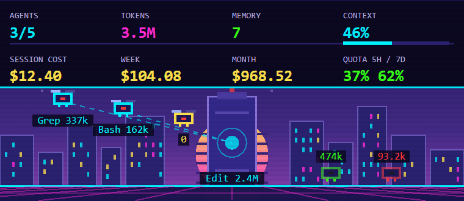
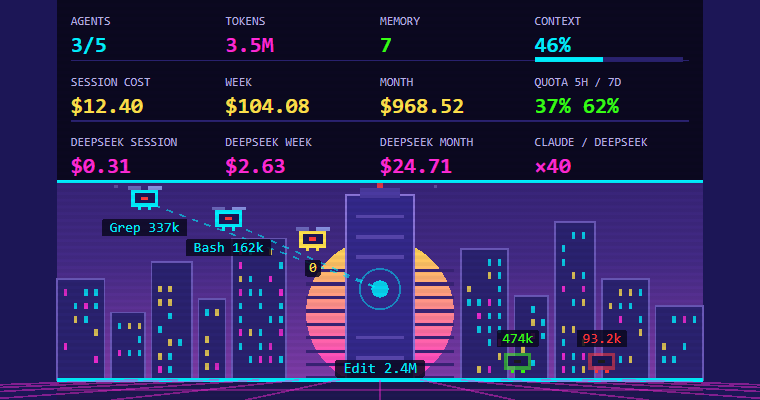

# Claude Consumption (VS Code)

Claude Consumption is a VS Code extension that visualizes Claude Code activity through an animated cyberpunk pixel-art dashboard: a neon city where every sub-agent is a drone, the main conversation is a tower with a beating heart, and a HUD shows tokens, context, costs and memory.



The extension reads the session transcripts Claude Code writes to disk and sits on the right of the editor, in the secondary side bar, below the Claude Code chat or in its own container. It does not depend on an internal API.

## What it shows

- **Agents**: one drone per sub-agent (`Agent`, fork, workflow, team). It flies while the agent works, lands in green once done, in red if it was stopped. Below each drone: its current tool and its tokens. On hover: its type, description and total.
- **Tasks**: the tool each loop is running right now (Bash, Grep, Edit…).
- **Tokens**: total per loop (input, output, cache read, cache written), session total, and context fill (CONTEXT bar, red above 80 %).
- **Costs**: the current session, then the current week and month across all sessions, from the `cost-state` lines Claude Code writes in its transcripts. Whatever was consumed since the last `cost-state` line, or a whole session without one, is estimated at the public API prices (a `≈` sign marks it); a session whose model has no known price counts as "unpriced" (`+n?` next to the month).
- **Memory**: number of entries in the project's `MEMORY.md` index (`~/.claude/projects/<project>/memory`).
- **5h / 7d quota**: the used share of the subscription windows, when the status line bridge is installed (see below); otherwise `--`.

The animation (stars, rotors, beams, the tower's heart, flickering windows) is carried by the SVG itself: the panel only redraws when the state changes.

## Installation

From a `.vsix` file (the one attached to a [release](https://github.com/aelmizeb/claude-consumption-vscode/releases), or the one `npm run package` produces):

```
code --install-extension claude-consumption-vscode-0.1.1.vsix
```

or, in VS Code, **Extensions → … → Install from VSIX…**.

The panel shows up at startup in the secondary (right) side bar, below the Claude Code chat. The **Claude Consumption: Open Panel** command brings it back to the front.

## Placement

By default (`claudeConsumption.dock` = `claude`), the panel is a view of the Claude Code extension's container in the secondary side bar: it shares the right column with the chat and only takes part of it, resizable by dragging the separator. It stays independent from the chat: its own window, state and data.

With `claudeConsumption.dock` = `own`, or when the Claude Code extension is not installed, it gets its own "Claude Consumption" container in the secondary side bar. Like any VS Code view, it can also be dragged to any bar or to the bottom panel.

## Where the data comes from

Claude Code writes every session to `~/.claude/projects/<project>/<session>.jsonl` (`CLAUDE_CONFIG_DIR` instead of `~/.claude` when set), and sub-agents to `<project>/<session>/subagents/agent-<id>.jsonl`. The extension re-reads these files incrementally every two seconds (`claudeConsumption.pollSeconds`):

- The tower is the most recently active session of the followed projects: those of the folders open in the window (`claudeConsumption.scope` = `workspace`) or every project on the machine (`all`).
- A loop is "running" after a user message or a tool call, "idle" after a final answer or without activity for `claudeConsumption.idleAfterSeconds`.
- Context is the size of the last request (input + cache) over the model's window (`claudeConsumption.contextWindow` forces a value).
- Week and month are scanned at startup, every five minutes and with the **Rescan Week and Month Costs** command; a session counts in the period of its last activity, unchanged transcripts are not re-read.

The **Claude Consumption** log (**Show Log** command) says which session is followed and how the last scan went.

## 5h / 7d quota: the status line bridge

Transcripts do not contain the subscription quota. Claude Code does hand it to its status line, though: the **Claude Consumption: Install the Status Line Bridge** command adds to `~/.claude/settings.json`

```json
"statusLine": { "type": "command", "command": "node \"<extension folder>/bridge/statusline.js\"" }
```

On every refresh, Claude Code runs this script, which writes the quota, context and cost to `~/.claude/claude-consumption/status.json` (read by the panel) and prints a sober status line (model, context, cost, quota). If you already have a status line, keep it and chain it yourself after the script, or install the bridge and point `claudeConsumption.statusFile` at the file it writes.

## Comparing with DeepSeek

Turn on `claudeConsumption.compareWithDeepSeek` to add a third HUD row: what the same tokens would have cost on DeepSeek's most expensive offer, `deepseek-v4-pro` at peak rates ($1.32 per million input tokens on a cache miss, $0.044 on a cache hit, $3.96 per million output tokens, from [DeepSeek's price list](https://api-docs.deepseek.com/quick_start/pricing/); off-peak rates are half of these), for the session, the week and the month, plus the Claude / DeepSeek ratio of the session. Tokens Claude read from its cache count as cache hits, tokens it wrote to its cache as misses. Sub-agents are included.



## Development

```
npm install
npm run compile      # or npm run watch
npm test             # unit tests (node:test) for the transcript reader, costs and scene
npm run package      # builds the .vsix
```

`F5` in VS Code launches a development window with the extension.

The repository has a GitHub Actions workflow that compiles, tests and attaches the `.vsix` to every release tagged `v*`.

## License

MIT.
